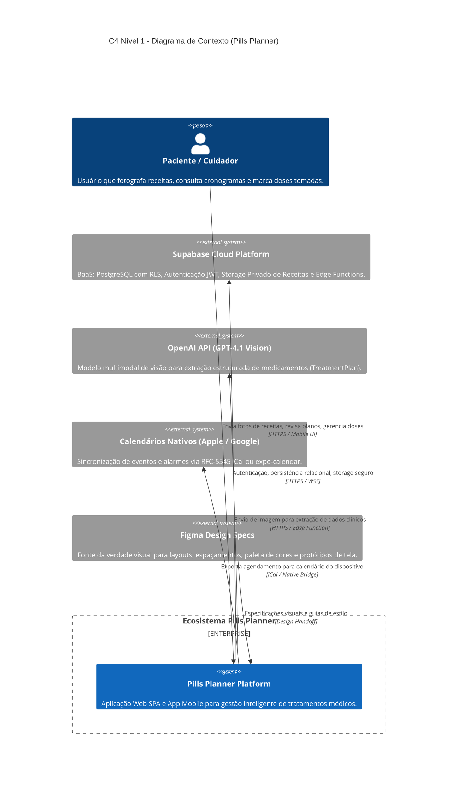
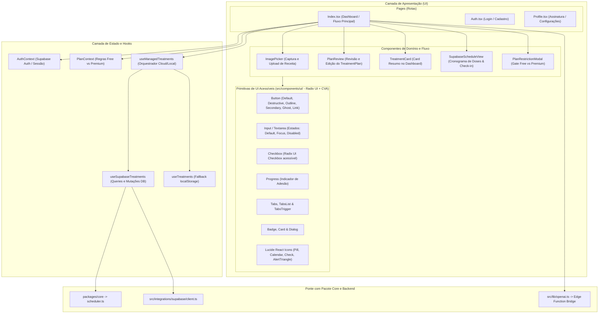
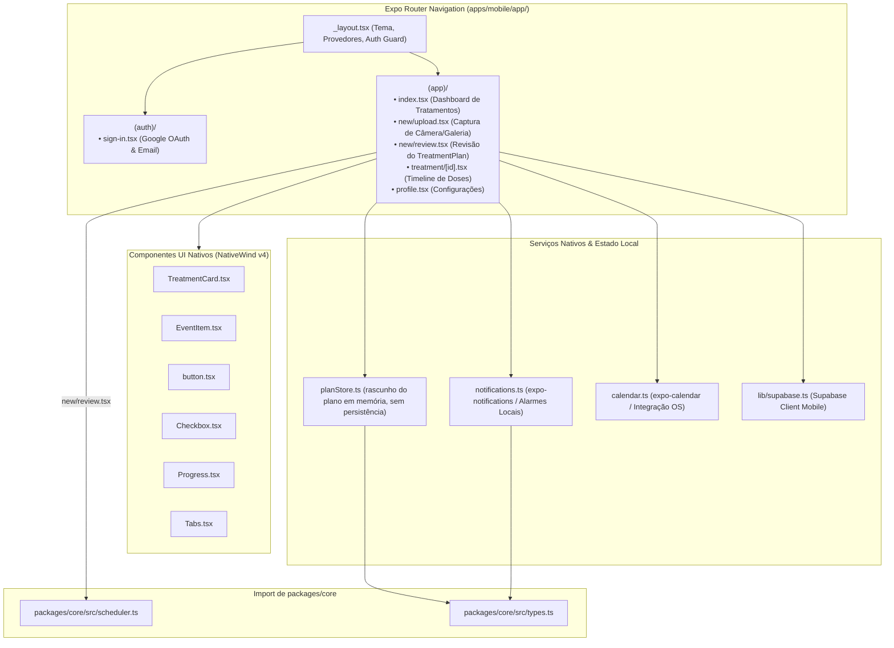
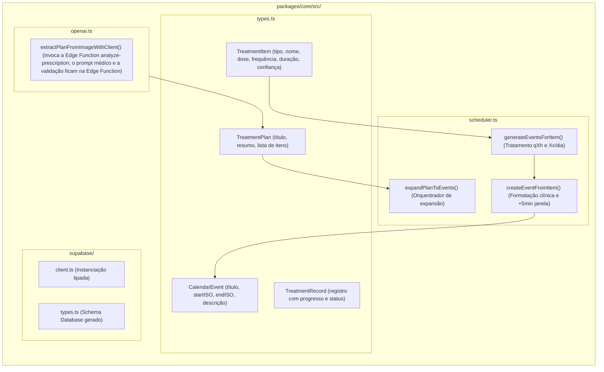
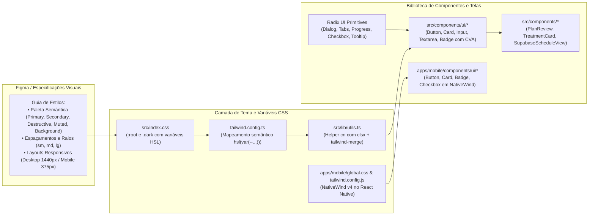
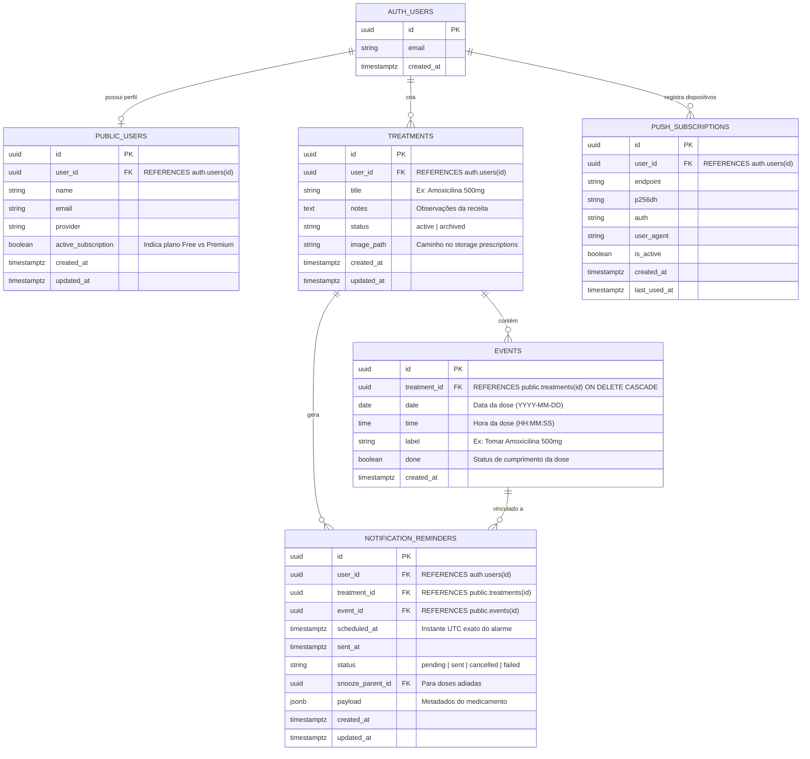

# Arquitetura do Sistema: Pills Planner (`pill-parse-plan`)

Documentação arquitetural de referência do sistema **Pills Planner**, incluindo modelos formais C4, diagramas de topologia, fluxo de dados clínicos, modelo de entidades e governança de qualidade.

---

## Índice

1. [Visão Geral e Contexto](#1-visão-geral-e-contexto)
2. [C4 Nível 1: Diagrama de Contexto do Sistema (System Context)](#2-c4-nível-1-diagrama-de-contexto-do-sistema-system-context)
3. [C4 Nível 2: Diagrama de Contêineres e Topologia Monorepo](#3-c4-nível-2-diagrama-de-contêineres-e-topologia-monorepo)
4. [C4 Nível 3: Diagrama de Componentes do Frontend Web](#4-c4-nível-3-diagrama-de-componentes-do-frontend-web)
5. [C4 Nível 3: Diagrama de Componentes do Aplicativo Mobile](#5-c4-nível-3-diagrama-de-componentes-do-aplicativo-mobile)
6. [C4 Nível 3: Diagrama do Motor de Domínio (`packages/core`)](#6-c4-nível-3-diagrama-do-motor-de-domínio-packagescore)
7. [Fluxo Funcional: Ciclo de Vida da Receita Médica (Sequence Diagram)](#7-fluxo-funcional-ciclo-de-vida-da-receita-médica-sequence-diagram)
8. [Arquitetura de UI e Sistema de Design (Radix UI + Tailwind CSS)](#8-arquitetura-de-ui-e-sistema-de-design-radix-ui--tailwind-css)
9. [Modelo de Dados Relacional e Segurança (ERD + RLS)](#9-modelo-de-dados-relacional-e-segurança-erd--rls)
10. [Governança de Qualidade: AI Cockpit Multi-Agent Pipeline](#10-governança-de-qualidade-ai-cockpit-multi-agent-pipeline)
11. [Matriz Comparativa Multiplataforma: Web vs. Mobile](#11-matriz-comparativa-multiplataforma-web-vs-mobile)

---

## 1. Visão Geral e Contexto

O **Pills Planner** é uma solução médica voltada à adesão farmacoterapêutica. O sistema permite ao paciente fotografar prescrições médicas manuais ou digitais, submetê-las a um extrator de visão computacional multimodal (OpenAI `gpt-4.1-2025-04-14` na Edge Function; o servidor Express legado usa `gpt-4o`) via backend seguro (Supabase Edge Functions), gerar um cronograma de doses determinístico com tratamento de timezones e horários preferenciais, e sincronizar eventos de alarme com a web e o ecossistema móvel nativo (iOS / Android).

### Premissas Inegociáveis
* **Segurança Clínica:** Nunca inferir doses ou frequências ausentes na receita. Havendo incerteza, o nível de confiança (`confidence < 1.0`) é reduzido e a interface solicita confirmação explícita ao paciente.
* **Disclaimer Médico Obrigatório:** Exibição explícita de um aviso informando que o sistema não substitui orientação profissional. Hoje o aviso está inline em `src/pages/Index.tsx`, `src/components/PlanReview.tsx` e `apps/mobile/app/(app)/new/review.tsx` (não há um componente `MedicalDisclaimer` compartilhado).
* **Isomorfismo de Domínio:** O motor de expansão de plano para eventos (`scheduler.ts`) reside exclusivamente em `packages/core`, garantindo paridade matemática exata entre Web e Mobile.
* **Acessibilidade e Consistência Visual:** Componentes fundamentados em primitivas acessíveis (Radix UI) com estilização semântica via Tailwind CSS v3.4 e variáveis de tema HSL centralizadas.

---

## 2. C4 Nível 1: Diagrama de Contexto do Sistema (System Context)

Mostra os limites do sistema e suas interações com usuários e provedores externos.



---

## 3. C4 Nível 2: Diagrama de Contêineres e Topologia Monorepo

Detalhamento da estrutura em monorepo (`pnpm-workspace.yaml` + Turborepo), seus pacotes e os serviços da infraestrutura de nuvem.

```mermaid
graph TB
    subgraph Monorepo["Monorepo (pnpm workspaces + Turborepo)"]
        subgraph WebApp["Root SPA (src/ na raiz do repo)"]
            ReactWeb["React 18.3.1 + Vite 5.4<br/>• Tailwind CSS 3.4<br/>• Radix UI + CVA<br/>• Lucide React Icons<br/>• React Router v6"]
        end

        subgraph MobileApp["apps/mobile"]
            ExpoApp["React Native 0.85 + Expo SDK 56<br/>• Expo Router (File-based)<br/>• NativeWind v4<br/>• expo-notifications (Local)<br/>• expo-calendar<br/>• planStore (store em memória do rascunho)"]
        end

        subgraph CorePackage["packages/core (Biblioteca Isomórfica)"]
            CoreTypes["Domain Types<br/>(TreatmentPlan, CalendarEvent, TreatmentItem)"]
            Scheduler["Scheduler Engine<br/>(expandPlanToEvents, timezone-safe)"]
            SupabaseShared["Supabase Client & Types"]
            OpenAIExtractor["extractPlanFromImageWithClient()<br/>(cliente da Edge Function)"]
        end
    end

    subgraph UIArchitecture["Camada de UI e Estilos"]
        FigmaParser["Figma Specs (Protótipos & Layouts)"]
        TailwindTheme["Tailwind CSS 3.4 & Variáveis CSS (:root HSL em index.css)"]
        RadixPrims["Radix UI Primitives + class-variance-authority"]
    end

    subgraph CloudServices["Supabase Cloud Infrastructure"]
        SupabaseAuth["Supabase Auth (JWT, Google OAuth, Email)"]
        PostgresDB["PostgreSQL 15+ com RLS<br/>• users<br/>• treatments<br/>• events<br/>• notification_reminders<br/>• push_subscriptions"]
        PrescriptionsBucket["Storage Bucket 'prescriptions' (Privado)"]
        EdgeFunctions["Deno Edge Functions<br/>• analyze-prescription (prompt médico)<br/>• openai-status"]
        ExpressLegacy["Servidor Express legado (server.js)<br/>• /api/openai/*<br/>• /api/push/subscribe<br/>• /api/notifications/schedule<br/>• cron de envio de push"]
    end

    subgraph ExternalAI["Provedores Externos"]
        OpenAIService["OpenAI API (GPT-4.1 Vision)"]
    end

    %% Dependências de Pacotes
    ReactWeb --> CorePackage
    ExpoApp --> CorePackage
    RadixPrims --> ReactWeb
    TailwindTheme --> ReactWeb
    FigmaParser -.-> TailwindTheme

    %% Comunicação de Rede
    ReactWeb -->|Auth & Queries RLS| SupabaseAuth
    ReactWeb -->|CRUD Tratamentos & Eventos| PostgresDB
    ReactWeb -->|Upload de Receita| PrescriptionsBucket
    ReactWeb -->|Chamada de IA via Edge| EdgeFunctions

    ExpoApp -->|Auth Google & Sessão| SupabaseAuth
    ExpoApp -->|Sincronização Offline/Online| PostgresDB
    ExpoApp -->|Upload de Imagem| PrescriptionsBucket
    ExpoApp -->|Chamada de IA via Edge| EdgeFunctions

    EdgeFunctions -->|Proxy Seguro com Chave Privada| OpenAIService
    ReactWeb -->|Web Push via /api (proxy Vite)| ExpressLegacy
    ExpressLegacy -->|Rota legada /api/openai| OpenAIService
    EdgeFunctions -->|Validação de Usuário| SupabaseAuth
    PostgresDB --- PrescriptionsBucket
```

---

## 4. C4 Nível 3: Diagrama de Componentes do Frontend Web

Organização interna das camadas de apresentação, estado e integração no frontend Web (`src/`).



---

## 5. C4 Nível 3: Diagrama de Componentes do Aplicativo Mobile

Estrutura e serviços nativos do aplicativo em `apps/mobile/`.



---

## 6. C4 Nível 3: Diagrama do Motor de Domínio (`packages/core`)

Módulos desacoplados de qualquer framework de visualização.



---

## 7. Fluxo Funcional: Ciclo de Vida da Receita Médica (Sequence Diagram)

Fluxo ponta a ponta desde a captura da imagem até o agendamento de doses.

```mermaid
sequenceDiagram
    autonumber
    actor Paciente as Paciente / Cuidador
    participant App as App (Web / Mobile)
    participant Edge as Supabase Edge Function (analyze-prescription)
    participant OpenAI as OpenAI Vision (GPT-4.1)
    participant Core as packages/core (Scheduler Engine)
    participant DB as Supabase PostgreSQL & Storage
    participant Alarm as Motor de Notificações (Local / Web Push)

    Paciente->>App: 1. Fotografa / Seleciona imagem da receita
    App->>DB: 2. Upload para bucket privado 'prescriptions' (somente Web; o Mobile ainda não envia a imagem)
    DB-->>App: 3. Retorna imagePath seguro
    
    App->>Edge: 4. POST /analyze-prescription (imageBase64, userNotes)
    Note over Edge: JWT verificado pelo gateway do Supabase (verify_jwt padrão); a função lê OPENAI_API_KEY dos secrets
    Edge->>OpenAI: 5. Chat Completion com prompt médico especializado
    OpenAI-->>Edge: 6. Retorna JSON bruto estruturado
    Note over Edge: Sanitiza, valida campos e índice de confiança (0..1)
    Edge-->>App: 7. Retorna 200 OK com TreatmentPlan

    App->>Paciente: 8. Exibe tela de revisão (PlanReview)
    Note over Paciente: Confere medicamentos, dosagens, frequências e observações clínicas
    Paciente->>App: 9. Ajusta horários e clica em "Confirmar Tratamento"

    App->>Core: 10. expandPlanToEvents(plan, startDateTime)
    Note over Core: Calcula intervalos (qXh ou Xx/dia) de forma determinística,<br/>insere observações e calcula instantes UTC
    Core-->>App: 11. Lista de CalendarEvent[] gerada

    App->>DB: 12. INSERT into treatments (title, notes, image_path, status)
    DB-->>App: 13. Retorna treatment.id
    App->>DB: 14. BATCH INSERT into events (treatment_id, date, time, label, done)
    
    App->>Alarm: 15. Agenda lembretes locais / push para cada dose
    App->>Paciente: 16. Exibe a agenda do tratamento (SupabaseScheduleView) com progresso ativo
```

---

## 8. Arquitetura de UI e Sistema de Design (Radix UI + Tailwind CSS)

Estrutura de estilização semântica, acessibilidade e compartilhamento de design entre Web e Mobile.



---

## 9. Modelo de Dados Relacional e Segurança (ERD + RLS)

Diagrama Entidade-Relacionamento com integridade referencial e isolamento de dados por usuário.



---

## 10. Governança de Qualidade: AI Cockpit Multi-Agent Pipeline

Pipeline determinístico de 12 etapas com auditoria de conformidade para prevenir regressões de layout, tokens e código.

> **Nota:** os agentes abaixo (`ui-orchestrator`, `spec-refiner`, `design-completeness`, etc.) descrevem o processo do AI Cockpit e não estão definidos neste repositório. O que existe aqui são as skills em `.claude/skills/` (importadas de `.aicockpit/skills/`), o comando `/create-specs` e o template em `_specs/`.

```mermaid
flowchart TD
    Demanda["Demanda do Usuário / Issue de UI"] --> Master["ui-orchestrator (Master Agent no Board)"]

    subgraph PipelineFidelidade["Pipeline de 12 Etapas (A até L)"]
        subgraph Especificacao["Etapas A-C: Especificação SMART"]
            SpecRefiner["spec-refiner<br/>• Gera _specs/<slug>.md<br/>• Critérios Gherkin<br/>• Matriz dos 5 Estados de UI"]
        end

        subgraph AuditoriaFigma["Etapas D-F: Inspeção e Auditoria"]
            DesignComp["design-completeness<br/>• Valida 5 estados no Figma<br/>• Valida 1440px / 375px"]
            DSVal["ds-validator<br/>• Zero nós desconectados<br/>• Auto-layout obrigatório"]
            FigmaInsp["figma-inspector<br/>• Extrai bound variables<br/>• Exporta baselines visuais"]
        end

        subgraph GeracaoECodigo["Etapas G-I: Código e Testes"]
            FigmaTrans["figma-transform<br/>• Gera React 18 / React Native<br/>• Primitivas Radix UI + Tailwind"]
            UIBuilder["ui-builder<br/>• Componentes e Hooks<br/>• Testes Vitest em src/test/"]
        end

        subgraph VerificacaoVisual["Etapas J-L: Validação e Testes"]
            VisualQA["Testes de Integração & Unidade<br/>• Paridade lógica entre Web e Mobile<br/>• Validação de agendamentos e regras clínicas"]
        end
    end

    subgraph QualityGate["Quality Gate Determinístico"]
        TSC["tsc --noEmit -p tsconfig.app.json / -p packages/core / -p apps/mobile (0 erros)"]
        ESLint["pnpm run lint (0 warnings/erros)"]
        Vitest["pnpm test (100% testes aprovados)"]
        BuildCheck["pnpm run build (Build de produção Vite)"]
        
        GateAudit{"Todos os Gates Aprovados?"}
    end

    Master --> SpecRefiner
    SpecRefiner --> DesignComp
    DesignComp --> DSVal
    DSVal --> FigmaInsp
    FigmaInsp --> FigmaTrans
    FigmaTrans --> UIBuilder
    UIBuilder --> VisualQA
    VisualQA --> QualityGate

    QualityGate --> TSC --> ESLint --> Vitest --> BuildCheck --> GateAudit
    GateAudit -- "SIM" --> Deploy["STATUS: APPROVED (Handoff para Produção / Build EAS)"]
    GateAudit -- "NÃO" --> AutoHealing["STATUS: REJECTED (Auto-healing / Retrabalho)"]
    AutoHealing -.-> UIBuilder
```



---

## 11. Matriz Comparativa Multiplataforma: Web vs. Mobile

| Capacidade | Aplicação Web (raiz do repo, `src/`) | Aplicação Mobile (`apps/mobile`) | Motor de Compartilhamento |
|---|---|---|---|
| **Ambiente de Execução** | Browser Desktop & Mobile | iOS e Android Nativo | JavaScript/TypeScript V8/Hermes |
| **Framework Base** | React 18.3.1 + Vite 5.4.19 | React Native 0.85 + React 19 + Expo SDK 56 | TypeScript 5.8 |
| **Navegação** | `react-router-dom` v6 | `expo-router` (File-based) | — |
| **Estilização** | Tailwind CSS v3.4 + Variáveis CSS (:root HSL) | NativeWind v4 + Tailwind CSS | Paleta Semântica HSL |
| **Biblioteca de UI** | Radix UI + Tailwind CSS (CVA) | Componentes Nativos (NativeWind) | Contrato de Props e Variantes |
| **Notificações** | Web Push API (Service Worker `public/sw.js` + servidor Express `server.js`) | `expo-notifications` (Alarmes locais nativos) | Tipos de Payload de Lembrete |
| **Calendário** | Exportação de arquivo `.ics` | `expo-calendar` (Gravação direta no app Nativo) | Gerador de Eventos RFC-5545 |
| **Captura de Imagem** | Input File HTML5 / Drag & Drop | Câmera nativa e Galeria de Fotos | Conversão base64 e envio seguro |
| **Regras de Negócio** | Consome `packages/core` | Consome `packages/core` | `packages/core/src/scheduler.ts` |
| **Armazenamento Offline** | `localStorage` / React Query cache | `AsyncStorage` (apenas sessão do Supabase); `planStore.ts` mantém só o rascunho em memória | Modelos de dados em `types.ts` |
