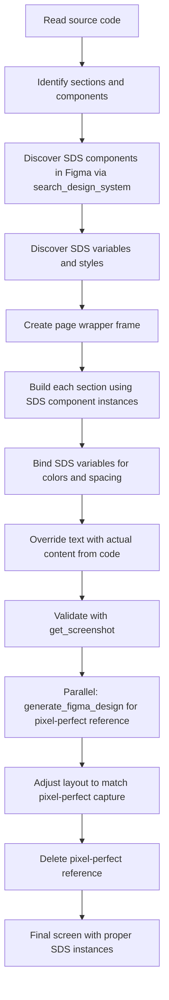
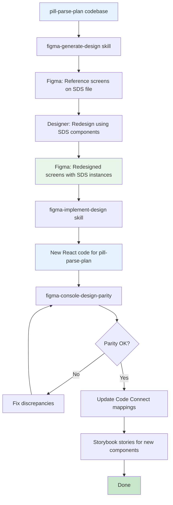

# Redesigning pill-parse-plan with SDS Figma File
## Complete Workflow Plan: Code ↔ Figma using MCP + Skills

---

## Overview

This plan covers two complementary workflows and how to combine them for a full redesign of `pill-parse-plan` using the SDS design system:

| Workflow | Direction | Skill | Purpose |
|----------|-----------|-------|---------|
| **A** | Code → Figma | `figma-generate-design` | Push existing screens to Figma as starting point |
| **B** | Figma → Code | `figma-implement-design` | Generate new code from redesigned Figma screens |

Both workflows require the **Figma MCP server** to be connected and use the **`figma-use` skill** as a mandatory prerequisite for any canvas write operation.

---

## Prerequisites

### Tools Required
- ✅ **Figma MCP server** connected (either `figma-desktop` or remote MCP)
- ✅ **AI Cockpit** with skills: `figma-use`, `figma-generate-design`, `figma-implement-design`
- ✅ **SDS Figma Community File** duplicated to your workspace
- ✅ **pill-parse-plan** running locally (`npm run dev` at `localhost:8080`)

### Figma Files Needed
1. **SDS Community File** — https://www.figma.com/community/file/1380235722331273046/simple-design-system
   - Duplicate this to your Figma workspace (File → Duplicate to your drafts)
   - This is your **design system source** — all SDS components, variables, and styles live here

2. **pill-parse-plan Redesign File** — Create a new Figma file for the redesign
   - Can be a new page inside the SDS file, or a separate file that links to SDS as a library

---

## Phase 0: Setup (One-Time)

### 0.1 — Duplicate SDS Figma File

1. Open https://www.figma.com/community/file/1380235722331273046/simple-design-system
2. Click **"Open in Figma"** → **"Duplicate to your drafts"**
3. Rename it: `SDS - pill-parse-plan Redesign`
4. Note the file URL — you'll need the `fileKey` (the segment after `/design/` in the URL)

### 0.2 — Enable SDS as a Team Library (Optional but Recommended)

If you want to use SDS components in a separate file:
1. In the SDS file → Main menu → **"Publish styles and components"**
2. In your redesign file → Assets panel → **"Enable library"** → select SDS

### 0.3 — Create Redesign Pages in Figma

Inside the SDS file (or your new redesign file), create pages for each pill-parse-plan screen:

```
Pages:
├── 🔴 Reference — Current App (screenshots/code-generated)
├── 🟡 Redesign — Dashboard
├── 🟡 Redesign — Plan Review
├── 🟡 Redesign — Schedule View
├── 🟡 Redesign — Treatment Card
└── 🟢 Tokens — Bridge Map
```

---

## Phase 1: Code → Figma (Push Existing Screens)

**Goal:** Create Figma representations of the current pill-parse-plan screens to use as redesign reference.

**Skill:** `figma-generate-design` + `figma-use`

### How It Works

The `figma-generate-design` skill reads your source code, discovers SDS components and variables in the target Figma file, and assembles screens section-by-section using design system tokens.

For web apps (like pill-parse-plan), it can also run `generate_figma_design` in parallel to capture a pixel-perfect screenshot of the running app, then use that as a visual reference while building the proper component-based version.

### Step-by-Step

**Step 1.1 — Start pill-parse-plan locally:**
```bash
cd pill-parse-plan
npm run dev
# App running at localhost:8080
```

**Step 1.2 — Identify screens to push:**

| Screen | Source File | Route |
|--------|-------------|-------|
| Dashboard | `src/pages/Index.tsx` | `/` |
| Plan Review | `src/components/PlanReview.tsx` | `/plan` |
| Schedule View | `src/components/ScheduleView.tsx` | `/schedule` |
| Treatment Card | `src/components/TreatmentCard.tsx` | component |

**Step 1.3 — Invoke the skill:**

Tell the AI agent:
```
Use the figma-generate-design skill to push the pill-parse-plan Dashboard screen 
(src/pages/Index.tsx) to Figma. Target the SDS file [YOUR_FILE_URL].
Place it on the "Reference — Current App" page.
Use SDS components and variables wherever possible.
The app is running at localhost:8080.
```

**Step 1.4 — Repeat for each screen.**

### What the Skill Does Internally



### Expected Output

- Figma frames on the "Reference — Current App" page
- Each frame uses SDS component instances (Button, Input, Card, etc.)
- Colors and spacing bound to SDS variables
- Serves as the baseline for redesign

---

## Phase 2: Redesign in Figma Using SDS Components

**Goal:** Redesign each screen using SDS components, applying the SDS visual language to the medical app context.

**This phase is done manually by the designer in Figma**, but the AI can assist with specific tasks.

### 2.1 — Token Mapping in Figma

Before redesigning, establish how SDS tokens map to the medical app's semantic needs:

| Medical Concept | SDS Token to Use | Notes |
|-----------------|-----------------|-------|
| Primary action (blue) | `--sds-color-background-brand-default` | SDS brand is grayscale — override for medical blue |
| Success/positive | `--sds-color-background-positive-default` | SDS green-500 |
| Danger/alert | `--sds-color-background-danger-default` | SDS red-500 |
| Warning | `--sds-color-background-warning-default` | SDS yellow-400 |
| Page background | `--sds-color-background-default-default` | White |
| Card background | `--sds-color-background-default-default` | White |
| Body text | `--sds-color-text-default-default` | Gray-900 |
| Secondary text | `--sds-color-text-default-secondary` | Gray-500 |

> **Note:** SDS brand is black/white/gray. For the medical app, you may want to override the brand color to medical blue (`#1a6fb5`) in your Figma variables while keeping the SDS token structure.

### 2.2 — Component Mapping

Map pill-parse-plan's existing shadcn components to SDS Figma components:

| pill-parse-plan Component | SDS Figma Component | Notes |
|--------------------------|---------------------|-------|
| `Button` (shadcn) | `Button` (SDS) | Map variants: default→primary, outline→neutral, ghost→subtle |
| `Card` (shadcn) | Custom frame with SDS tokens | SDS has no generic Card primitive |
| `Input` (shadcn) | `Input Field` (SDS) | Direct mapping |
| `Select` (shadcn) | `Select Field` (SDS) | Direct mapping |
| `Dialog` (shadcn) | `Dialog` (SDS) | Direct mapping |
| `Switch` (shadcn) | `Switch Field` (SDS) | Direct mapping |
| `Tabs` (shadcn) | `Tabs` (SDS) | Direct mapping |
| `TreatmentCard` (custom) | Custom composition using SDS primitives | Use SDS Button, Text, Tag |
| `PlanReview` (custom) | Custom composition | Use SDS Accordion, Button, Text |
| `ScheduleView` (custom) | Custom composition | Use SDS Table, Tag, Button |

### 2.3 — Redesign Workflow per Screen

For each screen:
1. Duplicate the reference frame to the redesign page
2. Replace shadcn-style components with SDS component instances
3. Apply SDS variables for all colors and spacing
4. Apply SDS text styles for typography
5. Validate with the original screenshot for functional parity

---

## Phase 3: Figma → Code (Generate New Implementation)

**Goal:** Generate production-ready React code from the redesigned Figma screens.

**Skill:** `figma-implement-design`

### How It Works

The `figma-implement-design` skill:
1. Reads `get_design_context` from the Figma node
2. Captures `get_screenshot` as visual reference
3. Translates to React code using the project's conventions
4. Maps Figma design tokens to the project's CSS variables / Tailwind utilities
5. Reuses existing components where possible

### Step-by-Step

**Step 3.1 — Get the Figma URL for each redesigned screen:**

In Figma, right-click the frame → **"Copy link"** to get the URL with `node-id`.

**Step 3.2 — Invoke the skill:**

Tell the AI agent:
```
Use the figma-implement-design skill to implement the redesigned Dashboard screen.
Figma URL: https://figma.com/design/YOUR_FILE_KEY/SDS-pill-parse-plan?node-id=XXX-YYY

Target project: pill-parse-plan (React + TypeScript + Tailwind + shadcn/ui)
- Use shadcn components where SDS Figma components are used
- Map SDS tokens to Tailwind utilities (sds-* utilities from tailwind.config.ts)
- Place output in src/pages/Dashboard.tsx
- Preserve existing data hooks (useAuth, usePricing, etc.)
```

**Step 3.3 — Component mapping instructions for the AI:**

Provide this mapping context when invoking the skill:

```
SDS Figma → Code Mapping:
- SDS Button (primary) → <Button variant="default"> from @/components/ui/button
- SDS Button (neutral) → <Button variant="outline">
- SDS Button (subtle)  → <Button variant="ghost">
- SDS Input Field      → <Input> from @/components/ui/input
- SDS Select Field     → <Select> from @/components/ui/select
- SDS Dialog           → <Dialog> from @/components/ui/dialog
- SDS Switch Field     → <Switch> from @/components/ui/switch
- SDS Tabs             → <Tabs> from @/components/ui/tabs
- SDS Tag              → <Badge> from @/components/ui/badge
- SDS Notification     → <Toast> via sonner
- SDS Text (heading)   → <h1-h6> with Tailwind typography classes
- SDS Flex             → <div className="flex gap-sds-400">
- SDS Section          → <section className="p-sds-800">
```

**Step 3.4 — Validate implementation:**

After code generation, use the `figma-console-design-parity` skill:
```
Use figma-console-design-parity to check the implementation of Dashboard.tsx
against the Figma design at [URL].
```

---

## Phase 4: Verify and Iterate

### 4.1 — Design Parity Check

Use the `figma-console-design-parity` skill to get a parity score and identify discrepancies:

```
Check design parity for src/pages/Dashboard.tsx against 
Figma URL: https://figma.com/design/YOUR_FILE_KEY?node-id=XXX-YYY
```

The skill returns:
- Parity score (0-100%)
- List of discrepancies (spacing, colors, typography)
- Priority ranking of issues to fix

### 4.2 — Component Documentation

Use the `figma-console-component-doc` skill to generate documentation for new components:

```
Generate component documentation for TreatmentCard from 
Figma URL: https://figma.com/design/YOUR_FILE_KEY?node-id=XXX-YYY
```

### 4.3 — Code Connect Update

After implementing the redesigned components, update the Code Connect mappings (from the previous integration plan):

```tsx
// src/components/TreatmentCard.figma.tsx — update to point to redesigned Figma node
figma.connect(TreatmentCard, "https://figma.com/design/YOUR_FILE_KEY?node-id=NEW_NODE_ID", {
  // updated props mapping
});
```

---

## Complete Workflow Diagram



---

## Skills Reference Card

| Task | Skill to Load | Trigger Phrase |
|------|--------------|----------------|
| Push code screen to Figma | `figma-generate-design` + `figma-use` | "push this screen to Figma", "create in Figma from code" |
| Generate code from Figma | `figma-implement-design` | "implement this design", "generate code from Figma URL" |
| Check design vs code parity | `figma-console-design-parity` | "check design parity", "audit design vs code" |
| Generate component docs | `figma-console-component-doc` | "document this component", "generate component spec" |
| Create Code Connect mappings | `figma-code-connect` | "create code connect", "map Figma to code" |
| Write to Figma canvas | `figma-use` (mandatory prerequisite) | Any `use_figma` call |

---

## Practical Tips

### Tip 1: Start with one screen end-to-end

Don't try to push all screens at once. Pick the simplest screen (e.g., `TreatmentCard`), complete the full cycle (Code → Figma → Redesign → Code), and use it as a template for the rest.

### Tip 2: The pixel-perfect parallel workflow

When using `figma-generate-design` with a running web app, the skill automatically:
1. Builds the screen using SDS component instances (proper design system linkage)
2. Captures a pixel-perfect screenshot via `generate_figma_design`
3. Adjusts the component-based version to match the pixel-perfect capture
4. Deletes the pixel-perfect capture

This gives you the best of both worlds: accurate layout AND proper design system components.

### Tip 3: Preserve data logic when generating code

When invoking `figma-implement-design`, always specify:
- Which data hooks to preserve (`useAuth`, `usePricing`, etc.)
- Which routing to keep (`react-router-dom`)
- Which state management patterns to follow

The skill generates UI code — data logic must be explicitly preserved.

### Tip 4: SDS brand color override for medical context

SDS brand is black/white/gray. For the medical app, create a **custom variable collection** in Figma that overrides the brand color:

```
In Figma Variables:
Collection: "Medical Override"
- brand-primary: #1a6fb5 (medical blue)
- brand-primary-hover: #1558a0
```

Then in the bridge CSS:
```css
:root {
  --sds-color-background-brand-default: #1a6fb5;
  --sds-color-background-brand-hover: #1558a0;
}
```

### Tip 5: Use `figma-generate-design` for new features too

Once the workflow is established, you can use `figma-generate-design` for any new feature:
1. Write the React code for the new feature
2. Push it to Figma to get a design representation
3. Designer refines in Figma
4. Use `figma-implement-design` to update the code

This creates a **bidirectional design-code workflow** where code and design stay in sync.

---

## File Checklist

### In Figma
- [ ] SDS Community File duplicated to workspace
- [ ] "Reference — Current App" page created
- [ ] Redesign pages created (one per screen)
- [ ] SDS library enabled (if using separate file)
- [ ] Medical brand color override variables created

### In pill-parse-plan
- [ ] `src/sds-tokens.css` added (from previous integration plan)
- [ ] `tailwind.config.ts` extended with `sds-*` utilities
- [ ] `.storybook/` configured
- [ ] `figma.config.json` created
- [ ] `.figma.tsx` files created for each component
- [ ] New redesigned pages implemented in `src/pages/`
- [ ] Code Connect mappings updated to point to redesigned Figma nodes

---

## Estimated Effort

| Phase | Effort | Who |
|-------|--------|-----|
| Phase 0: Setup | 1-2 hours | Dev + Designer |
| Phase 1: Code → Figma (5 screens) | 2-4 hours | AI-assisted |
| Phase 2: Redesign in Figma | 1-3 days | Designer |
| Phase 3: Figma → Code (5 screens) | 3-6 hours | AI-assisted |
| Phase 4: Verify + iterate | 2-4 hours | Dev + Designer |
| **Total** | **~2-4 days** | |

The AI-assisted phases (1 and 3) are largely automated via the skills. The main human effort is Phase 2 (design work) and Phase 4 (review and iteration).