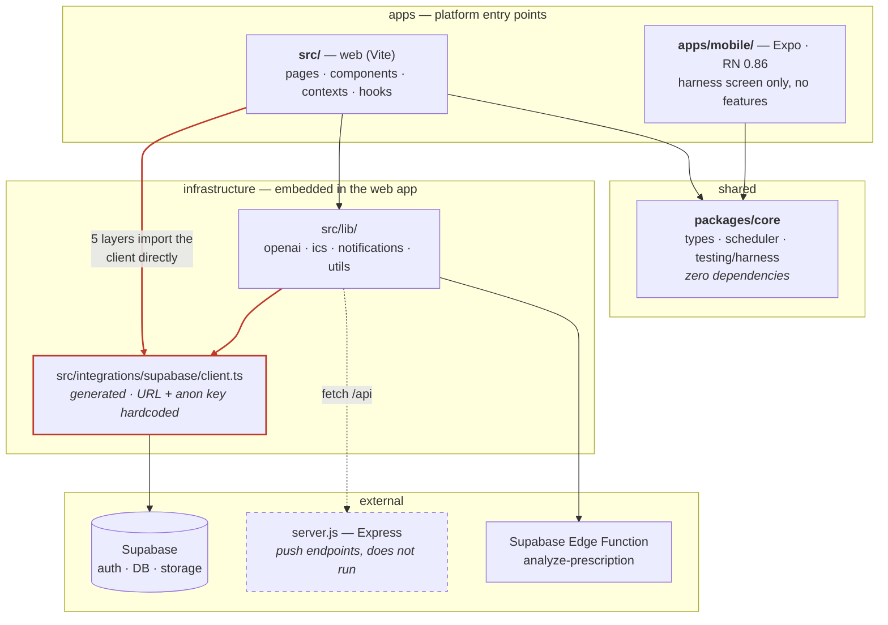
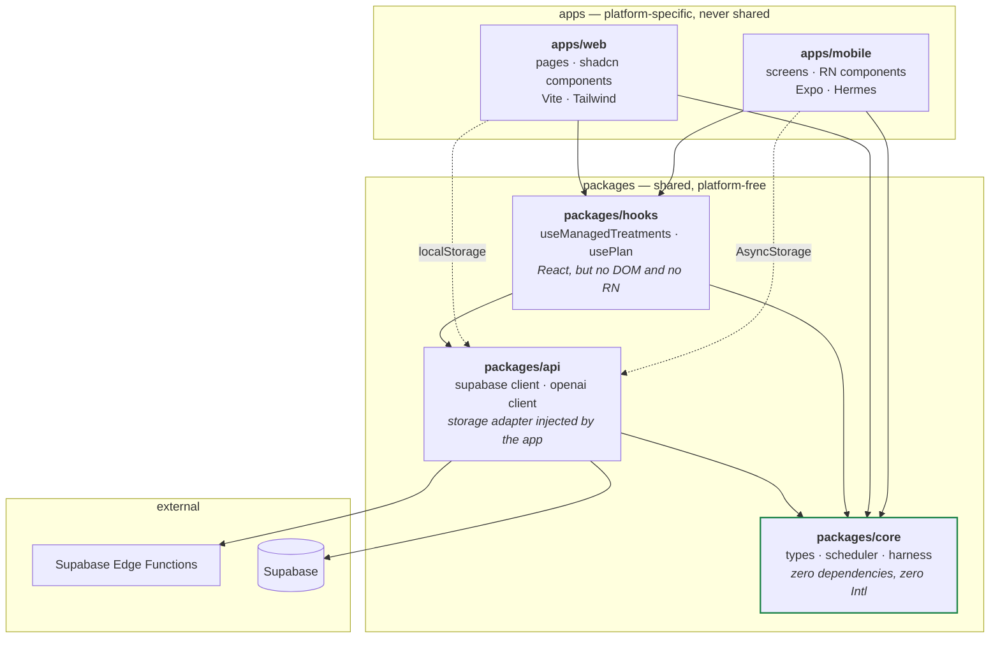

# Architecture — current state and target

The structural contract for this repo. `_specs/core/*.spec.md` govern *behavior*; this file
governs *shape* — what may depend on what, and why.

It exists because the React Native migration makes structure load-bearing. Code that can be shared
between web and mobile is code with no platform dependencies; everything else has to be written
twice. The layering below is not aesthetic preference, it is the difference between writing the
app once and writing it twice.

---

## The one rule

**Dependencies point inward. A layer may import from layers below it, never above.**

```
apps  →  hooks  →  api  →  core
```

`core` imports nothing. `api` knows about `core` but not about React or any app. `hooks` knows
about `api` and `core` but not about a specific app. Apps know about everything below them.

That is the whole of it. It is the one idea worth taking from Clean Architecture; the rest —
entities, use-case interactors, ports and adapters as separate object hierarchies — is ceremony
this codebase is too small to repay.

**Why it earns its place here specifically:** the further inward a module sits, the more platforms
can share it. `packages/core` is shared verbatim by web and Hermes today, proven by
`_specs/parity-matrix.md`. Every inward-pointing dependency you add is code you will not rewrite
for mobile.

---

## Current state



**What the diagram is telling you.** `packages/core` is clean and genuinely shared — that part
works. Everything else is a single undifferentiated web app with infrastructure threaded through
it:

- **The Supabase client is imported from five layers**: `pages/` (2 files), `components/` (1),
  `contexts/` (2), `hooks/` (1), `lib/` (2). `Auth.tsx` and `Profile.tsx` talk to the database
  directly. There is no seam to swap, mock, or share — a mobile port of `Profile` would rewrite
  the data access rather than reuse it.
- **No `api` or `hooks` package exists.** Business logic lives inside React components and hooks
  that also import platform APIs, so none of it is portable as written.
- **`server.js` is unreachable** — its dependencies are not installed, and nothing invokes the
  reminder cron. Drawn dashed because it is nominally part of the architecture and factually not.
- The generated `client.ts` hardcodes the project URL and anon key, so "point it at another
  project" is a regeneration, not configuration.

None of this is an emergency. It is a normal Lovable-generated app. It is also the reason a mobile
port currently means rewriting nearly everything above `packages/core`.

---

## Target



Dotted edges are **inversions**: the app supplies its platform storage to `api` at startup rather
than `api` reaching for a global. That single injection is what lets one Supabase client serve both
`localStorage` on web and `AsyncStorage` on React Native.

### What may import what

| Layer | May import | May **never** import |
|---|---|---|
| `packages/core` | nothing | everything — including `Intl` / `toLocale*` |
| `packages/api` | `core` | React, React Native, DOM, any app |
| `packages/hooks` | `core`, `api`, `react` | React Native, DOM, any app |
| `apps/web` | all packages | `apps/mobile` |
| `apps/mobile` | all packages | `apps/web`, `@/*` |

**`packages/core` bans `Intl` and `toLocale*` specifically.** Hermes delegates those to platform
ICU on Android, so output varies by device — it would break parity in a way no Node test would
catch. `formatEventForDisplay` was deleted for exactly this reason. Formatting belongs in an app,
where the platform is known.

---

## Getting there

Ordered by payoff per unit of disruption. Each step leaves the tree green.

| # | Step | Unlocks |
|---|---|---|
| 1 | ✅ `packages/core` extracted, parity proven on Hermes | Done — `b681969`, `511e854` |
| 2 | `packages/api` — move `integrations/supabase` + `lib/openai`, inject the storage adapter | The 5-layer coupling collapses to one import site |
| 3 | Route all data access through `api`; no component or page imports a client | A mobile screen can reuse the data layer |
| 4 | `packages/hooks` — lift `useManagedTreatments` logic out of React components | Business rules become testable and shared |
| 5 | Move `src/` → `apps/web` | Symmetry; deferred until now because it pays off only with a second app |

Step 2 has prerequisites already recorded in `_specs/parity-matrix.md`: the generated
`client.ts` hardcodes credentials, `types.ts` is missing two tables, and the two OpenAI handlers
disagree on model.

---

## Enforcement

Rules that are not executable get ignored. This repo has the evidence: a dead `useTreatments`
branch nothing removed, and a rules file describing an entirely different codebase that sat in
`.aicockpit/rules/` misleading agents until it was deleted. So both rules above are enforced by
machinery, not review:

- **`eslint.config.js`** — per-layer `no-restricted-imports`. Violations fail `npm run lint` with a
  message naming the rule and the reason.
- **`packages/core/src/__tests__/purity.test.ts`** — scans every shipped file in `packages/core`
  and fails on any non-relative import, any platform global, any `Intl`/`toLocale*`, and any
  entry in the package's `dependencies`. This is AC-T04 of `_specs/core/types.spec.md`.

The lint rules catch structural drift at edit time. The purity test catches the subtler runtime-API
drift that would build fine and break only on a device.
